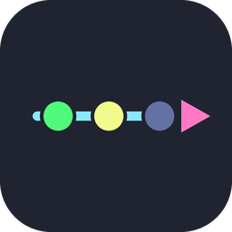
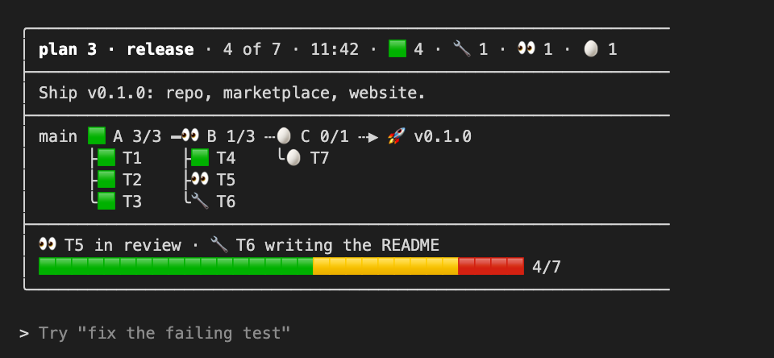

<p align="center"></p>

<h1 align="center">taskrail</h1>

<p align="center">
  <a href="https://github.com/drolosoft/taskrail/releases/latest"></a>
  <a href="https://opensource.org/licenses/MIT"></a>
  
</p>

> **🛤️ A live board of your session's plan, right above the prompt.**

taskrail is a Claude Code mod. When Claude works through a plan with several tasks, the board shows the waves, the tasks under each one and the state each task is in, updated by Claude itself as the work moves. You pick how much of it you see with `/taskrail`.

<p align="center"></p>

---

### Install

```bash
claude plugin marketplace add drolosoft/claude-plugins
claude plugin install taskrail@drolosoft-marketplace
```

Start a new session, or run `/reload-plugins`. `/plugin` then lists it as `1 mod active · taskrail`.

For one session with a local copy: `claude --plugin-dir ./taskrail`.

### Modes

| `/taskrail …` | What the band shows |
|---|---|
| `full` | The whole board: header, description, rail, tasks, key line and progress bar (the default) |
| `bar` | One line: project, plan, time, a station per wave, the goal, ten tiles and the time left |
| `both` | The whole board, and Claude also pastes it in the chat at every milestone |
| `off` | Nothing in the band; Claude shows the board in the chat only when you ask |

`/taskrail` alone answers the current mode. The choice is kept across sessions.

If you already have a skill or a command named `taskrail`, Claude Code keeps yours and refuses the mod's. The board and the three tools still work, in the mode last chosen; rename yours to get `/taskrail` back.

### How Claude uses it

The mod registers three tools. Claude calls them on its own when it runs a plan with several tasks; you can also ask for them by name.

| Tool | What it does |
|---|---|
| `plan` | Starts (or replaces) the board: project, title, goal, description and the waves with their task ids. Every task starts 🥚. |
| `set` | Updates task icons by id, the key line, the goal, the title or the description. Its result tells Claude what the current mode asks of the chat. When a wave that has begun still has two or more tasks in 🥚 and at most one running, the result adds one line saying so (never on the board), so Claude starts the independent ones at once. |
| `show` | Returns the board as text, for the chat. |

Icons: 🥚 pending · 🔧 working · 👀 in review · 🩹 fixing · 🧪 testing · 🟩 merged · 🚀 shipped · 🔑 needs you · 👻 missing · 🧟 stale · 💥 broken · 🥱 idle · 🛑 stopped. The header counts each of these icons in use. A wave's station is 🟩 when every task is merged; otherwise it shows the most pressing state among its tasks, in this order: 🛑 🔑 💥 🧟 👻 🩹 👀 🧪 🔧 🚀, else 🥚. The "N of M" counts 🟩 only; the tiles are green for 🟩, yellow for the running states (🔧 👀 🩹 🧪, at least one tile while anything runs) and red for the rest. After the tiles, once the first task is done, a guess of the time left (`7/14 · ~18m left`): the wall time since the first task started, divided by the tasks done, is what one task costs with the waves running as they run, and every task not done owes that much less what it has already run. `plan` and `set` also take a `note`, the key line under the rail. `set` reads ✅ (and ✔️, ☑️) as 🟩; any other icon outside this list is refused, the task keeps its icon and the result names the valid ones.

Each task keeps the time of its last move, when it first left 🥚 and when it reached 🟩 or 🚀. The full board and `show` print it after the task: how long it has run while it is under way (`🔧 T4 · 12m`), how long it took once it is done (`🟩 T4 · 48m`), in minutes under an hour and `1h12m` above; nothing for a pending task or under a minute. A wave's column widens to fit its times. The header keeps the time of the last update, and the `bar` mode shows no task times. A plan saved by an earlier version draws as before: the tasks it had under way show no time, and its pending ones are timed once they start.

### Running the waves fast

The plugin ships a skill, `running-waves`, that Claude loads when it runs a plan with several tasks. It holds the rules that keep the waves fast, measured on real runs: subagents never wait on each other's processes, each worktree has its own port and test server, anything long runs in the background, only the tests of what changed run while iterating, a server is not rebuilt when nothing changed, briefs are short, and independent plans run at once. Several tasks in 🔧 at the same time is the board working as intended; one 🔧 at a time means the waves are being run in series.

### What moves on its own

Claude does not have to report everything. The mod listens to the engine's own agent events and moves a task when they are clear enough:

| Event | What the board does |
|---|---|
| A subagent is spawned whose description or name carries a task id (`Implement T4`) | ties the agent to the task; a task nobody was on (🥚 🥱 👻 🧟) becomes 🔧 |
| That agent asks you for a permission | the task becomes 🔑 while it waits |
| The agent calls its next tool | the task takes back the icon it had; with nothing held, the call counts as news of the task |
| The agent's turn ends | an answer hands a working task (🔧 🔑 🧟) to 👀; an error or a refusal makes it 💥; an interruption 🛑 |
| Fifteen minutes go by with no `set` and no agent event touching a task in 🔧 👀 🩹 🧪 | the task becomes 🧟; the key line stays as it was. The next `set` or event moves it on as usual |
| Five minutes go by since a task became 🟩 | the task leaves the rows and the rows close up, so a long plan keeps the band short; the header, the stations, the "N of M" and the tiles still count it. A 🚀 task stays in sight |

The stale check runs once a minute, and also whenever the board is drawn. A task waiting for you (🔑) never goes stale.

A task that is 🟩 or 🚀 is never touched, and `set` still has the last word: an icon Claude sets stays until an event with something new to say. Name the task id in each `Agent` call's description and the board follows it.

The plan lives in the session's plugin state and in the plugin store under the session id, so it survives `/resume`, including a restart of Claude Code followed by `--resume`. `/clear` drops the plan along with the conversation, and a new session starts with no plan. The ties between agents and tasks live in the session only: agents do not survive a resume.

### What it reads and writes

Nothing outside Claude Code. taskrail opens no network connection and reads or writes no file. It keeps the plan in the plugin's session state and in the plugin store, and draws it in the band above the prompt. When one of its hooks fails (a plan the renderer cannot draw, say) it writes one dim line under its name in the transcript and lets the event through; it never takes a turn, a tool call or the band down with it.

### Requirements

- Claude Code 2.1.287 or later.
- Works in the terminal, the IDE extensions and the desktop app's Code tab. Mods do not run in the VS Code chat panel, in `claude -p`, or in cloud sessions.

### Development

```bash
claude plugin validate --strict .
claude plugin test .
claude --plugin-dir .
```

Saving a file reloads the mod in a session started with `--plugin-dir`. Do not load the same mod from `--plugin-dir` and from the marketplace in one session: two plugins named `taskrail` would register the same tools twice.

### Contributing

See [CONTRIBUTING.md](CONTRIBUTING.md). Security reports go by email, see [SECURITY.md](SECURITY.md).

### License

MIT. Copyright (c) 2026 Drolosoft.
